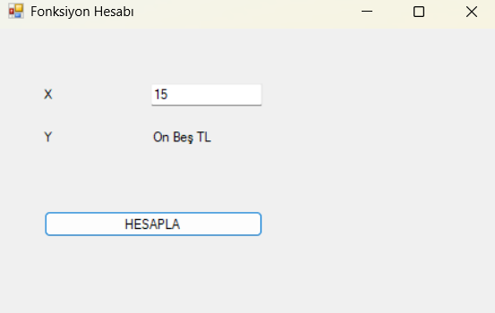

# 🔢 Sayıyı Yazıya Çevir (C# Windows Forms)

Bu proje, girilen sayısal para tutarlarını (Türk Lirası ve Kuruş basamaklarıyla) Türkçe metin karşılığına dönüştüren bir Windows Forms masaüstü uygulamasıdır.

Sakarya Üniversitesi Bilgisayar Mühendisliği Bölümü **Nesneye Dayalı Programlama** dersi kapsamında geliştirilmiştir.

---

## 📸 Ekran Görüntüsü

  

---

## ✨ Özellikler

- **Tamsayı ve Ondalıklı Değer Desteği:** Hem tam sayıları hem de virgüllü/noktalı değerleri ayrıştırır.
- **Otomatik Para Birimi Formatı:** Virgülden önceki kısmı **TL**, virgülden sonraki kısmı **Krş** olarak metne dönüştürür.
- **Basamak Çözümleme:** 6 basamağa kadar olan sayıları basamak mantığıyla analiz edip metne çevirir.
- **Sade Arayüz:** Kullanıcı dostu ve hızlı Windows Forms tasarımı.

---

## 🛠️ Kullanılan Teknolojiler

- **Programlama Dili:** C# (.NET Framework)
- **Arayüz:** Windows Forms (WinForms)
- **Geliştirme Ortamı:** Visual Studio
